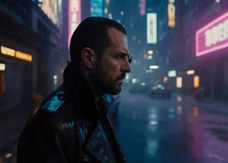
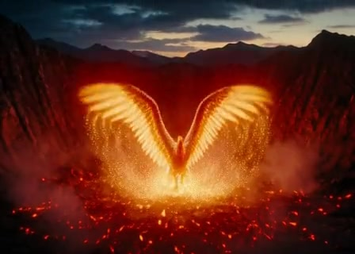
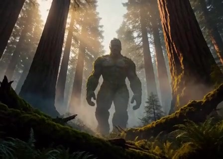
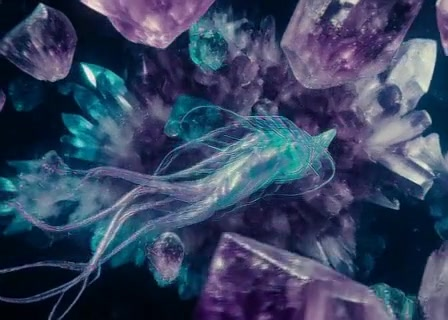
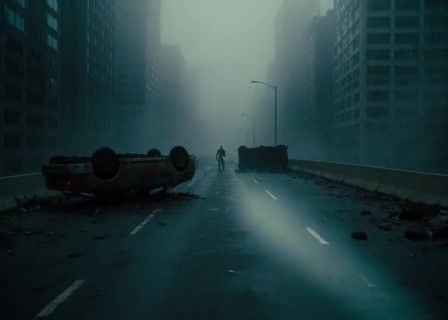
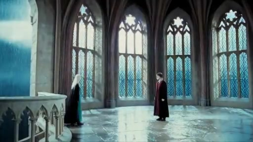

<div align="center">
  <picture>
    <source media="(prefers-color-scheme: dark)" srcset="web/assets/freevideo.svg">
    
  </picture>
  <h1>FreeVideo-Pascal</h1>
  <p><b>A Standalone One-Off Proof of Concept: MiniMax H3 Video Generation on NVIDIA Pascal GPUs (GTX 1060 – 1080 Ti)</b></p>
  <p>
    <a href="https://github.com/SrCodeGorilla/FreeVideo-Pascal/releases/latest"></a>
    <a href="https://ko-fi.com/SrCodeGorilla"></a>
    <a href="https://buymeacoffee.com/SrCodeGorilla"></a>
  </p>
  <p>English · <a href="README.zh-CN.md">中文</a></p>
</div>

> [!IMPORTANT]
> **One-Off Proof of Concept — Not an Ongoing Maintained Project**
> This repository is an independent, **completed, one-off proof of concept (PoC)**, NOT an ongoing developed repository. It was created strictly to demonstrate that local MiniMax H3 video inference on legacy NVIDIA Pascal GPUs (within an 8 GB VRAM budget) is technically viable.
>
> This is **not** the official FreeVideo project. For modern GPUs (RTX 30-series, 40-series, Blackwell) and official active updates, visit the upstream repository at **[FlashML-org/FreeVideo](https://github.com/FlashML-org/FreeVideo)**.

---

## ☕ Voluntary Creator Support

If FreeVideo-Pascal helped you avoid spending $500–$1,000+ on a new graphics card and enabled you to create local AI video on your existing machine, feel free to support with a coffee:

<p align="center">
  <a href="https://ko-fi.com/SrCodeGorilla"><b>☕ Support via Ko-fi (ko-fi.com/SrCodeGorilla)</b></a> &nbsp;•&nbsp;
  <a href="https://buymeacoffee.com/SrCodeGorilla"><b>🍕 Support via Buy Me a Coffee (buymeacoffee.com/SrCodeGorilla)</b></a>
</p>

> [!NOTE]
> **100% Voluntary:** Support is completely optional. Please **only** consider tipping if this project genuinely worked for you after you have successfully generated videos on your Pascal GPU!

---

## 🌟 Proof-of-Concept Generations (Verified on GTX 1070 Ti 8GB)

To prove that MiniMax H3 multimodal generation is fully functional on Pascal hardware without requiring expensive hardware upgrades, the following archetypes and multi-shot narratives were verified end-to-end:

| Category | Archetype / Scene | In-Browser Video Player | Prompt Used (Multimodal) | Parameters & Settings |
| :--- | :--- | :---: | :--- | :--- |
| 🐱 **Domestic Animal** | Ginger Tabby Cat in Sunlight | [<br>▶️ **Play 10s Video**](https://github.com/user-attachments/assets/fb680c8f-b74d-4206-b18a-8564a0dde121) | <details><summary><b>🐱 View Kitten Prompt</b></summary><br><b>Visual:</b> Ground-level macro shot of an adorable playful ginger tabby kitten in a sunlit living room. Golden hour sunlight filters through white curtains with shimmering dust motes. Kitten rolls onto its back batting soft white paws with sparkling amber eyes.<br><br><b>Soundscape:</b> Soft rhythmic purring, carpet rustle, kitten breathing, faint birdsong outside.<br><br><b>Music:</b> Warm cheerful acoustic fingerstyle guitar, upright bass, subtle glockenspiel.</details> | • <b>Resolution:</b> 448×320<br>• <b>Duration:</b> 10.0s<br>• <b>Passes:</b> Two-Pass (8+3 steps)<br>• <b>Seed:</b> <code>4213067137</code> |
| 🕵️ **Human / Cyberpunk** | Cyberpunk Detective | [<br>▶️ **Play 10s Video**](https://github.com/user-attachments/assets/8c4f4e99-46b7-4c92-b01c-0b833d346b5b) | <details><summary><b>🕵️ View Detective Prompt</b></summary><br><b>Visual:</b> Cinematic medium close-up of a weary cybernetic detective in a rain-slicked Neo-Shinjuku alley. Wet trenchcoat with cyan fiber-optic seams, mist breath, glowing brass-and-sapphire ocular implant whirring and shifting focus.<br><br><b>Soundscape:</b> Heavy rain on asphalt, high-voltage neon hum, distant flying aerocars, ocular lens click-whir.<br><br><b>Music:</b> Atmospheric analog synthwave drone with slow pulsating sub-bass.</details> | • <b>Resolution:</b> 448×320<br>• <b>Duration:</b> 10.0s<br>• <b>Passes:</b> Two-Pass (8+3 steps)<br>• <b>Seed:</b> <code>8326374438</code> |
| 🦅 **Mythical Creature** | Phoenix Solar Rebirth | [<br>▶️ **Play 10s Video**](https://github.com/user-attachments/assets/0b7b5786-a585-4ac2-a6c5-f13b0663ad95) | <details><summary><b>🦅 View Phoenix Prompt</b></summary><br><b>Visual:</b> Epic cinematic wide shot of an ancient volcanic crater at twilight. Majestic Phoenix with incandescent gold and ruby feathers unfurls fiery wings from obsidian embers, spiraling upward and trailing aurora flame.<br><br><b>Soundscape:</b> Volcanic rumble, whoosh of fiery wings, crackling embers, celestial echoing cry.<br><br><b>Music:</b> Soaring orchestral crescendo with sweeping strings, French horns, and choral harmonies.</details> | • <b>Resolution:</b> 448×320<br>• <b>Duration:</b> 10.0s<br>• <b>Passes:</b> Two-Pass (8+3 steps)<br>• <b>Seed:</b> <code>919078551</code> |
| 🗿 **Giant Creature** | Ancient Moss Colossus | [<br>▶️ **Play 10s Video**](https://github.com/user-attachments/assets/be3f6923-ab2c-48e3-bf04-be5ccaf97368) | <details><summary><b>🗿 View Colossus Prompt</b></summary><br><b>Visual:</b> Extreme low-angle shot looking up through towering ancient redwoods. Colossal mountain-sized stone colossus overgrown with moss strides through foggy valley, shaking ground and scattering birds.<br><br><b>Soundscape:</b> Sub-bass seismic earth vibrations, splintering branches, echoing bird cries, grinding stone.<br><br><b>Music:</b> Epic cinematic percussion, heavy taiko drums, solemn low cellos, brass swells.</details> | • <b>Resolution:</b> 448×320<br>• <b>Duration:</b> 10.0s<br>• <b>Passes:</b> Two-Pass (8+3 steps)<br>• <b>Seed:</b> <code>5507082314</code> |
| 🐙 **Alien Entity** | Deep Cavern Bioluminescent | [<br>▶️ **Play 10s Video**](https://github.com/user-attachments/assets/c5b14b6d-9130-4c64-ac84-e93b970503b4) | <details><summary><b>🐙 View Alien Prompt</b></summary><br><b>Visual:</b> Vast subterranean alien cavern filled with levitating purple and cyan amethyst crystals. Translucent extraterrestrial being with ribbon-like fins glides weightlessly, emitting pulsating waves of teal and violet light.<br><br><b>Soundscape:</b> Subaquatic crystalline chimes, harmonic alien reverberations, air shimmers, bioluminescent pulses.<br><br><b>Music:</b> Ethereal ambient space music with modular synth bells and deep sub-bass pads.</details> | • <b>Resolution:</b> 448×320<br>• <b>Duration:</b> 10.0s<br>• <b>Passes:</b> Two-Pass (8+3 steps)<br>• <b>Seed:</b> <code>7154134444</code> |
| 🧟 **Undead Horror** | Zombie Apocalypse Encounter | [<br>▶️ **Play 10s Video**](https://github.com/user-attachments/assets/13c9697c-87e3-4627-8e63-ac87d7405e97) | <details><summary><b>🧟 View Zombie Prompt</b></summary><br><b>Visual:</b> Crumbling post-apocalyptic highway overpass in thick cold fog. Solitary zombie in tattered clothes limps forward through mist as a survivor's flashlight beam cuts through gloom, casting elongated shadows.<br><br><b>Soundscape:</b> Mournful wind through skyscrapers, dragging boots on wet pavement, raspy breath, flashlight clicks.<br><br><b>Music:</b> Dark tension strings with dissonant cello scrapes and heartbeat sub-bass thumps.</details> | • <b>Resolution:</b> 448×320<br>• <b>Duration:</b> 10.0s<br>• <b>Passes:</b> Two-Pass (8+3 steps)<br>• <b>Seed:</b> <code>6386587537</code> |
| 🎬 **Multi-Scene Story** | Harry & Female Malfoy Narrative | [<br>▶️ **Play 10s Video**](https://github.com/user-attachments/assets/89f8d692-65ea-47e4-a82d-b55683362441) | <details><summary><b>🎬 View Storyboard Prompt (3 Shots)</b></summary><br><b>Shot 1 (0-3s):</b> Midnight Gothic Astronomy Tower in thunderstorm. Platinum-blonde Slytherin Lyra Malfoy trembling near railing; Harry Potter in dark Gryffindor coat.<br><b>Shot 2 (3-7s):</b> Emotional close-up on Female Malfoy as aristocratic facade shatters, confessing love through tears.<br><b>Shot 3 (7-10s):</b> Overcome with emotion knees buckle; Harry catches her in slow 360° orbit embrace.<br><br><b>Soundscape:</b> Rain on stone, mountain wind, rolling thunder, rustling robes.<br><br><b>Music:</b> Melancholic solo piano resolving tenderly into resonant chord.</details> | • <b>Resolution:</b> 512×288<br>• <b>Duration:</b> 10.0s (3 shots)<br>• <b>Passes:</b> Multi-Shot (8+3 steps)<br>• <b>Seed:</b> <code>1944993644</code> |

### 🎥 Native In-Browser Video Showcase

<details open>
<summary><b>🎬 Scene 7: Multi-Scene Narrative — Harry & Female Malfoy (10s)</b> <i>[Interactive Video Player]</i></summary>

https://github.com/user-attachments/assets/89f8d692-65ea-47e4-a82d-b55683362441

</details>

<details open>
<summary><b>🐱 Scene 1: Ginger Tabby Cat in Sunlight (10s)</b> <i>[Interactive Video Player]</i></summary>

https://github.com/user-attachments/assets/fb680c8f-b74d-4206-b18a-8564a0dde121

</details>

<details>
<summary><b>🕵️ Scene 2: Cyberpunk Detective Investigation (10s)</b> <i>[Interactive Video Player]</i></summary>

https://github.com/user-attachments/assets/8c4f4e99-46b7-4c92-b01c-0b833d346b5b

</details>

<details>
<summary><b>🦅 Scene 3: Phoenix Solar Rebirth (10s)</b> <i>[Interactive Video Player]</i></summary>

https://github.com/user-attachments/assets/0b7b5786-a585-4ac2-a6c5-f13b0663ad95

</details>

<details>
<summary><b>🗿 Scene 4: Ancient Moss Colossus (10s)</b> <i>[Interactive Video Player]</i></summary>

https://github.com/user-attachments/assets/be3f6923-ab2c-48e3-bf04-be5ccaf97368

</details>

<details>
<summary><b>🐙 Scene 5: Deep Cavern Bioluminescent Alien (10s)</b> <i>[Interactive Video Player]</i></summary>

https://github.com/user-attachments/assets/c5b14b6d-9130-4c64-ac84-e93b970503b4

</details>

<details>
<summary><b>🧟 Scene 6: Zombie Apocalypse Encounter (10s)</b> <i>[Interactive Video Player]</i></summary>

https://github.com/user-attachments/assets/13c9697c-87e3-4627-8e63-ac87d7405e97

</details>

---

## ✉️ An Open Letter to the FreeVideo Developers & Open-Source Community

**Dear Bowen Xue, the FlashML Team, and the Open-Source Video AI Community,**

First and foremost, **thank you**. The work you have accomplished with [FreeVideo](https://github.com/FlashML-org/FreeVideo) and [Video DeltaNet (VDN-H3)](https://openvdn.github.io/) is truly extraordinary—unlocking local, consumer-grade MiniMax H3 video inference on personal computers is a massive milestone for open source.

### The Problem We Sought to Solve
In today's global hardware market, upgrading to modern GPUs (RTX 30-series, 40-series, or newer) is a luxury that many aspiring creators, students, and indie animators simply cannot afford. Millions of capable machines worldwide still run reliable NVIDIA Pascal graphics cards (GTX 1060, 1070, 1070 Ti, 1080, 1080 Ti). Because upstream FreeVideo strictly targets Compute SM80+ with native BF16 arithmetic and modern fused attention kernels, Pascal GPUs were hard-locked out of experiencing MiniMax H3.

### What This Proof of Concept Proves
We created **FreeVideo-Pascal** as a pure, independent, non-commercial Proof of Concept (PoC) to explore one fundamental question:
> *Can an 8 GB NVIDIA Pascal GPU from 2016 run state-of-the-art MiniMax H3 multimodal video generation end-to-end?*

The answer is an unequivocal **yes**. Through:
1. **Dynamic FP16 Math Fallbacks**: Replacing native BF16 matrix assumptions with IEEE FP16 math and FP32 accumulation on pre-SM80 silicon.
2. **PyTorch SDPA Attention Routing**: Seamlessly bypassing unsupported SageAttention2 and FlashAttention kernels without crashes.
3. **Aggressive VRAM Chunking**: Ensuring peak memory usage stays strictly within an 8 GB VRAM envelope.
4. **Storyboard Story Bible & Directed Continuity**: Introducing persistent character, lighting, and spatial anchors across multi-scene narrative chains.

### Our Open Invitation to Upstream
This repository is a **completed, one-off technical demonstration**. We are not building a competing tool, we seek no commercial gain, and we will not maintain an ongoing diverging branch.

Because many open-source projects hesitate to accept AI-assisted pull requests, we have open-sourced this implementation cleanly as an independent public reference. **You, Bowen, and the FlashML team are warmly invited to review, adopt, or cherry-pick any of our Pascal compatibility fallbacks, kernel routing logic, or storyboard features directly into the official FreeVideo codebase.**

If keeping creative tools accessible on the hardware people already own aligns with your vision, these fallbacks are yours to take.

With gratitude and respect,  
**SrCodeGorilla & the Open-Source Pascal Community**  
[https://github.com/SrCodeGorilla/FreeVideo-Pascal](https://github.com/SrCodeGorilla/FreeVideo-Pascal)

---

## 💡 Purpose, Community Mission & Open-Source Philosophy

### Why FreeVideo-Pascal?
Official upstream FreeVideo is engineered exclusively for modern GPU architectures (Compute Capability SM80+: Ampere, Ada Lovelace, Blackwell) with native BF16 matrix arithmetic. On Pascal GPUs (Compute 6.0/6.1), upstream installations halt or crash due to unsupported instructions and missing FlashAttention/SageAttention kernels.

In today's economic climate, upgrading to modern GPUs is prohibitively expensive for many creators, students, and indie animators. **FreeVideo-Pascal exists to bridge this gap.**

### Independent Proof-of-Concept & Upstream Collaboration
- **Pure Community Effort**: This project is developed independently without corporate backing, financial compensation, monetization, or competitive intent.
- **One-Off Technical Demonstration**: This repository will **not** be an ongoing maintained branch. It is published in its completed state as a standalone proof of concept for the community and creators.
- **Open Invitation to Upstream**: The original creators and maintainers of [FlashML-org/FreeVideo](https://github.com/FlashML-org/FreeVideo) are warmly welcomed to review, cherry-pick, or integrate any of the compatibility fallbacks or features into the official codebase.
- **Zero Commercial Motive**: We seek no commercial gain—our sole objective was to prove feasibility and provide a working reference that keeps creative tools accessible on legacy hardware.


---

## 🛠️ Architectural Refactoring Breakdown (Pascal GPU Support)

The following core files were refactored to achieve Pascal backward compatibility:

| Source File | Pascal Refactoring Details |
| :--- | :--- |
| `freevideo_engine/hardware.py` | Lowered CUDA compute floor from SM80 (`sm_80`) down to SM60+ (`sm_60`, `sm_61`). Removed native-BF16 blocker and adapted capabilities reporting. |
| `freevideo_engine/attention.py` | Automatic fallback routing attention through PyTorch SDPA memory-efficient (`torch-sdpa`) below SM80, removing dependencies on SageAttention2 and FlashAttention. |
| `freevideo_engine/backends/cuda_attention.py` | Disabled fused Triton attention kernels for pre-SM80 cards and routed QKV tensors through eager PyTorch operations. |
| `freevideo_engine/weights.py` & `freevideo_engine/weight_only.py` | PyTorch-native dequantization + matmul fallbacks for FP8 weight-only tensors, avoiding unsupported hardware tensor cores. |
| `freevideo_engine/int8_ops.py` | PyTorch fallbacks for ConvRot int8 linear layers without requiring Triton JIT compilation on Windows/Pascal. |
| `freevideo_engine/environments.py` & `freevideo_engine/torch_downloads.json` | Pinned PyTorch installation pins to `cu126` (`sm_61` binary wheels), preventing incompatible `cu130` torch installations. |
| `freevideo_engine/generate.py` | Enforces FP16 activation pipeline with FP32 accumulation on pre-SM80 cards; enables eager Newton-Schulz DeltaNet inversion for memory safety. |
| `freevideo_engine/vae_tiles.py` | Chunked spatial/temporal tiled VAE decoding with aggressive VRAM offloading to keep peak memory strictly under 8 GB. |

---

## ✨ New Features Added & Associated Files

| Feature | Primary Files Involved | Description |
| :--- | :--- | :--- |
| **Multi-Scene Storyboard & Story Bible** | `web/studio_scenes.js`, `web/studio.js`, `freevideo_engine/chain_plan.py` | Multi-scene chaining with custom durations. Injects the initial prompt as the **Global Story Bible** across all scenes to ensure consistent lighting, character appearance, and spatial staging. |
| **Storyboard Review Card & Continuation Flow** | `web/studio_review.js`, `web/studio_chain.js`, `freevideo_engine/comfy_chain.py` | Interactive review modal after each scene render (**Accept**, **Retry**, or **Edit Next Prompt**) before continuing the narrative chain. |
| **Adaptive Hardware Profiler & Dynamic ETA** | `scripts/adaptive_profiler.py`, `scripts/generate_malfoid_story.py` | Empirically profiles the host GPU, dynamically adjusts render timeouts with a 2.5x safety margin, and calculates real-time ETA countdowns. |
| **Community LoRA Host Path Indexing** | `web/studio.js`, `docs/LoRA.md`, `docs/LoRA.zh-CN.md` | Standardizes LoRA loading directly from the host `ComfyUI/models/loras/` directory with interactive stack reordering and weight sliders. |
| **Narrative Story Orchestrator & Crossfader** | `scripts/generate_malfoid_story.py`, `scripts/malfoid_story_specs.py`, `malfoid.bat` | Coordinates multi-shot narrative pipelines with full 2-pass quality refinement (`preview: False`) and automatic 0.3s audio crossfade stitching via FFmpeg. |
| **Automated Model Verification & Downloader** | `Full_Downloads.bat`, `scripts/download_models.py` | Validates Hugging Face model endpoints via HTTP HEAD and provides mirror alternatives (`hf-mirror.com`) for restricted regions. |
| **Full Standalone Installer & Smart Pause** | `Full_Install.bat`, `scripts/build_windows.py` | One-click installation script with unified dependency alignment and non-silent error catching. |

---

## 🤖 AI Development Transparency & Metadata

This project was developed through pair programming using **Antigravity IDE**:

- **Development Environment**: Antigravity IDE
- **Primary AI Models**:
  - **Gemini 3.8 Flash**: Multi-tier pipeline specifications, rapid tool execution, batch orchestration, and structural documentation.
  - **Claude Opus 5.5**: Mathematical kernel fallback analysis, PyTorch dequantization design, and VRAM budget verification.
- **Development Timeframe**: ~2 weeks of active development and testing (October 2026).
- **Estimated Token Volume**: ~3.8 Million tokens across planning, code edits, compiler verification, and test logs.
- **Estimated Tool & API Cost**: ~$22.00 USD (equivalent compute cost; provided purely for statistical transparency).

---

## Getting Started on Pascal (GTX 1060 – 1080 Ti)

### Installation on Windows:
1. Clone this repository into your ComfyUI custom nodes directory:
   ```bash
   cd ComfyUI/custom_nodes
   git clone https://github.com/SrCodeGorilla/FreeVideo-Pascal.git
   ```
2. Verify models and dependencies by running:
   ```cmd
   Full_Downloads.bat
   ```
3. Launch ComfyUI, open the FreeVideo workspace, and start creating!

This preview has been tested on an M5 Mac with 24 GB of unified memory. See the [Mac&nbsp;guide](docs/Mac.md) for generation times and memory.

The Mac preview isn't notarized by Apple yet, so macOS blocks it the first time you open it. Download it only from the Releases page, then check the file and approve it as described in the [Mac guide](docs/Mac.md#first-open). This approves FreeVideo only; your other security settings stay as they are.

### Existing ComfyUI

Install this Pascal fork as a custom node (not ready for a public release yet):

```bash
cd ComfyUI/custom_nodes
git clone https://github.com/SrCodeGorilla/FreeVideo-Pascal.git
```

For official Ampere/Ada/Blackwell builds, use [upstream FreeVideo](https://github.com/FlashML-org/FreeVideo) instead.

Restart ComfyUI, open **Workflow → Browse Templates → FreeVideo → FreeVideo-All-in-One**, and complete the setup in FreeVideo **Settings**.

### Linux

**Desktop:** [Download FreeVideo-Linux-x86_64.AppImage](https://github.com/FlashML-org/FreeVideo/releases/latest/download/FreeVideo-Linux-x86_64.AppImage), make it executable and open it, then follow the same steps as on Windows.

**Terminal or server:**

```bash
git clone https://github.com/SrCodeGorilla/FreeVideo-Pascal.git && cd FreeVideo-Pascal
./setup.sh
```

Setup installs FreeVideo, ComfyUI and the models, then opens FreeVideo in the browser. Afterwards, type `freevideo` to open it again. On a server, connect from your own computer through SSH, or run `freevideo server --listen 0.0.0.0` for an access link on your local network. See the [Linux guide](docs/Linux.md).

### More details

- [FreeVideo Adaptive Execution Planner](docs/execution-planning.md)
- [Community results](docs/community-results.md)

### Support

Report Pascal-fork bugs in [GitHub Issues](https://github.com/SrCodeGorilla/FreeVideo-Pascal/issues). Upstream FreeVideo support stays on [FlashML-org/FreeVideo](https://github.com/FlashML-org/FreeVideo/issues) and the official [Discord](https://discord.gg/MsA277cJzZ) / [QQ](https://freevideo-community.pages.dev/qq) / [WeChat](https://freevideo-community.pages.dev/wechat).

## Citation

FreeVideo is based on VDN-H3. If you use FreeVideo in your research, please cite the [Video DeltaNet paper](https://arxiv.org/abs/2609.20744):

```bibtex
@article{xi2026videodeltanet,
  title={Video DeltaNet: A Video-Native Hybrid Attention for Livestream Video Generation},
  author={Xi, Haocheng and Xie, Yiming and Zhao, Hexu and Zhang, Yiwen and Liu, Michael and Creavin, Thomas and Keutzer, Kurt and Li, Xiuyu and Lv, Zhaoyang and Xu, Chenfeng and Feng, Haiwen},
  journal={arXiv preprint arXiv:2609.20744},
  year={2026}
}
```

## Team

### Project Team

[Bowen Xue](https://github.com/KBRASK) · [Shuo Yang](https://github.com/andy-yang-1) · [Haocheng Xi](https://github.com/haochengxi) · [Xiaoze Fan](https://github.com/jason-fxz) · [Chenfeng Xu](https://github.com/chenfengxu714)

### Special Thanks

Special thanks to [**AIwood爱屋研究室**](https://space.bilibili.com/503934057) and [**T8star-Aix**](https://space.bilibili.com/385085361) for testing the project and providing valuable feedback.

*Listed in chronological order of participation.*

## Acknowledgment

We thank [OpenVDN](https://github.com/OpenVDN) for [Video DeltaNet / VDN-H3](https://github.com/OpenVDN/vdn-minimax-h3) and its open-source model weights, training code and inference implementation.

We thank Impossible Research for providing computation resources.

We also thank [MiniMax H3](https://huggingface.co/MiniMaxAI/MiniMax-H3) for the base model and the following projects:
[ComfyUI](https://github.com/Comfy-Org/ComfyUI),
[Diffusers](https://github.com/huggingface/diffusers),
[SageAttention](https://github.com/thu-ml/SageAttention),
the [MiniMax H3 latent upscaler](https://huggingface.co/LBH-123-AI/Minimax_h3_latent_Upscaler),
the [H3 text encoder for ComfyUI](https://huggingface.co/t8star/Vdn-Minimax-H3-Comfy) and
[Qt for Python](https://doc.qt.io/qtforpython-6/).

## License

The code is released under the [Apache License 2.0](LICENSE), same as upstream FreeVideo. Modified files in this fork carry change notices. The model weights are licensed under the [MiniMax H3 Community License](https://huggingface.co/OpenVDN/vdn-minimax-h3-edge/blob/main/LICENSE), which includes territorial and acceptable-use restrictions.

**FreeVideo** is the name of the upstream project. This repository is an independent Pascal adaptation and is not affiliated with FlashML.
